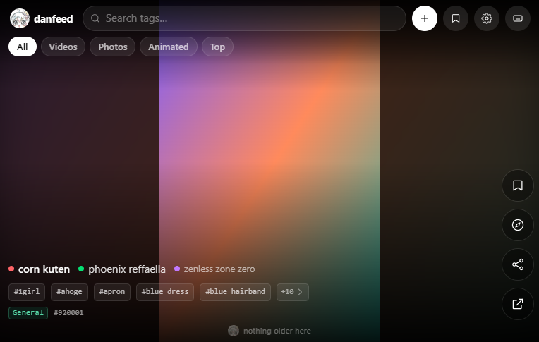
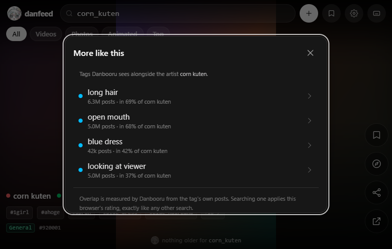
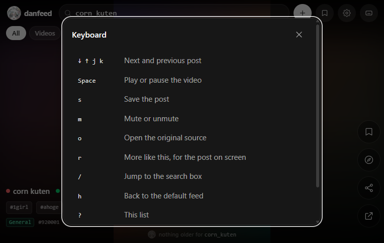

# danfeed

A TikTok-style vertical feed for Danbooru — swipe through photos, videos, GIFs and ugoira, search by tag, or paste your own URL.

Pure client-side: no backend, no accounts, no build server. Everything it needs is `danbooru.donmai.us` + `cdn.donmai.us`.

**Live:** https://danfeed.porterfrag.workers.dev/ · [](https://github.com/Porterfrag/danfeed/actions/workflows/ci.yml)

## Screenshots

  

A post, "More like this", and the keyboard map. All three come from `npm run shots -- --readme`:
the real build, screenshotted in headless Chrome against a placeholder image. The setting is
deliberate: a gallery label under each post, tags in mono because they are codes rather than names,
and chrome that steps back once you stop touching it. No artwork is included in this repository —
every image the app shows is loaded from Danbooru at runtime.

## What it does

| Feature | Notes |
| --- | --- |
| Mixed feed | Photos, videos, GIFs and ugoira in one snap-scroll feed |
| Search | **Autocomplete** on the word being typed (`chun` → `chun-li`) |
| Tag limit | Enforced locally, with a remove-tag panel — the 422 is never sent |
| Filter chips | All · Videos · Photos · Animated · Top |
| Add by URL | Danbooru post page, direct media file, or YouTube/Vimeo embed |
| Saved | Stored in `localStorage`; double-tap a video or use the rail button |
| Browsable tags | Every tag on a slide is one tap from a search; `+N` opens the full list |
| More like this | Tap the compass — or press `r` — for what Danbooru sees alongside the post's artist (or character, or series); every row is a search, at this browser's rating. The list ahead is prefetched only after the sheet has been opened once |
| Fetch ahead | The next page is asked for once a few slides are left, not when the bottom arrives |
| Tag actions | Hold a tag chip — or right-click it — to search it here, open it on Danbooru, read its wiki, or copy the search link |
| Rating | Safe by default; Moderate/Everything opt-in per browser, with the mode stamped beside the wordmark |
| Recent searches | An empty search box offers your last few searches; tap one to run it again |
| Backup | Saved posts, recent searches and settings to one JSON file — and back in, merged |
| Share | Copy the post link, the media link, or a `?q=` link that opens this search elsewhere |
| Home | Tap the **danfeed** logo to reset: default feed, cleared search, back to top |
| Settings | Content rating, video size cap, start-with-sound, reset history |
| Keyboard | `↑`/`↓` or `j`/`k` scroll · `space` pause · `m` mute · `s` save — `?` lists the rest |
| Failures | A dropped connection or a 5xx is retried twice before the error card; a 4xx is final |
| Offline shell | A service worker keeps the app itself cached, so it opens without a network (the API and the media still need one) |
| Quiet chrome | Four seconds without a touch and the label and the rail step back to a quarter; any pointer, key or new slide brings them straight back |
| Motion | `prefers-reduced-motion` stops the autoplay, the gliding scroll, the caption settle and the sheet animations |

## Deliberate limits

The interesting half of a client like this is what it refuses to do.

- **No accounts, no sync.** Saved posts, recent searches and settings live in `localStorage`; a
  backup file is how they move between browsers.
- **No media mirroring.** Every image and video is loaded from `cdn.donmai.us`. Nothing is
  re-hosted, proxied or cached by this project.
- **Safe by default.** The feed is `rating:general` until you opt in per browser, and a shared link
  never carries your setting.
- **Two tags is Danbooru's limit**, not this app's. The app counts tags locally and refuses to send
  the 422, rather than pretending the limit isn't there.
- **No DNS tricks.** If your network blocks `*.donmai.us`, the app says so; it will not try to route
  around your provider.
- **No server.** The hosted build is a static bundle and a service worker. There is nothing to sign
  up for and nothing that knows who you are.

## Keyboard

| Key | |
| --- | --- |
| `↓` `j` | Next post |
| `↑` `k` | Previous post |
| `space` | Play or pause the video |
| `s` | Save the post |
| `m` | Mute or unmute |
| `o` | Open the original source |
| `r` | More like this, for the post on screen |
| `/` | Jump to the search box |
| `h` | Back to the default feed |
| `?` | This list, in the app |

Shortcuts stay out of the way while the search box has focus or a sheet is open, and `Escape`
closes whatever is in front.

## Run

```bash
npm install
npm run dev
```

## Build

```bash
npm run build
npm run preview
```

## Tests

```bash
npm run verify                    # lint + build + every end-to-end suite
npm run test:e2e                  # the suites alone (builds first)
npm run test:e2e -- tags rating   # a subset, reusing the current dist
npm run shots                     # PNGs of the UI in tests/__shots__ (gitignored)
npm run shots -- --readme         # and refresh the three PNGs in docs/ that this README shows
```

The suites in `tests/` drive the production build in headless Chrome and speak CDP directly — no
test runner, no dependencies. They cannot use the live API (some networks DNS-block `*.donmai.us`,
and Cloudflare fingerprints headless Chrome), so every request is answered from a fixture. A Chrome,
Chromium or Edge binary is required; `CHROME_PATH` points at it when it is not in the usual place.
`tests/run.mjs` gives each suite its own browser with a throwaway profile, and prints each built
file's size and short SHA-256. Those fingerprints identify this build, not the hosted one: a host
that compiles from git produces its own hashes, so compare sizes rather than hashes against a
deployment.

| Suite | Covers |
| --- | --- |
| `tests/tags.mjs` | the general tag row, and the all-tags sheet behind `+N` |
| `tests/entities.mjs` | artist / character / series chips: caps, de-duplication, exact searches |
| `tests/rating.mjs` | the tag string that actually goes on the wire at each rating level |
| `tests/search-panel.mjs` | the suggestion panel must stay out of the feed |
| `tests/history.mjs` | recent searches: what is remembered, and what stays quiet |
| `tests/backup.mjs` | exporting a backup file, and merging one back in |
| `tests/share.mjs` | share links, `?q=` links, and the preview metadata crawlers read |
| `tests/keyboard.mjs` | every shortcut, where it must stay quiet, and the sheets it opens |
| `tests/tag-actions.mjs` | holding a chip: the sheet, the click it swallows, stacked sheets, Escape |
| `tests/retry.mjs` | which failures are repeated and which are final, for the API and for media |
| `tests/pwa.mjs` | the service worker, the shell it caches, and opening offline |
| `tests/a11y.mjs` | reduced motion, the live region, the dialog contract, the feed's structure |
| `tests/discover.mjs` | fetching ahead of the finger, related tags, and the gate on both |

## Network requirement

Danbooru must be reachable **from your browser**. Some ISPs (and some DNS resolvers) redirect
`*.donmai.us` to a block page. The app detects that failure mode and shows a diagnostic screen
instead of a blank feed — it cannot work around it for you.

Fix it with Secure DNS or a VPN:

- Chrome / Edge — Settings → Privacy and security → Use secure DNS → Cloudflare
- Or any VPN / DNS resolver that returns the real Cloudflare IPs

## Licence

The code is MIT (`LICENSE`); the artwork — the mascot, its crops and the app icons — is all rights
reserved (`NOTICE` names exactly which files that covers).

danfeed is an unofficial client of Danbooru's public API and is not affiliated with it. No media is
hosted here: every image and video is loaded from `cdn.donmai.us` and belongs to the artist or
uploader who posted it.
